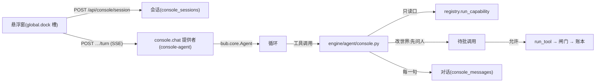

# 运行时参考

> 状态:现行 | 日期:2026-11-16
> 读者:后端、运维
> 口径:基于当前代码;阈值与 TTL 为代码常量,改动时同步本文。

## 服务与端口

| 服务 | 端口 | 说明 |
| --- | --- | --- |
| engine | 8000 | FastAPI;健康检查 `/api/health` |
| web | 3000 | Nuxt 3;开发时经 Nitro 同源代理 `/api/**` → engine |
| postgres | 5432 | pgvector/pgvector:pg16;业务表 + DBOS schema |
| redis | 6379 | 只承载可丢失的临时状态 |

## 工作流

| 工作流 | 触发 | 链路 |
| --- | --- | --- |
| `issue_triage_workflow` | issues opened/edited | Sensor 分析 → 落库 → `issue.triaged` Hook → `intent.propose` → 效果单元(回评,可撤销) |
| `fix_suggestion_workflow` | 评论含来源声明的触发词(GitHub 是 `@gwei`,CNB 是 `@CodeBuddy`) | 落库 → 配了 `HARNESS_COMMAND` 就整场交给 harness(它改工作区里的代码,效果仍从出口落成,通常是 `pr.open`),收口后在原话题上回一句结果;没配才退回 补丁建议 → `patch.generated` transform → `intent.propose` → 回评 |
| `release_workflow` | 任何来源的合并事件(GitHub PR / GitLab MR / CNB PR) | 合并提交 → 发布意图(`compose.release`)→ 指定下游的变更单元 → 来源支持回评时回帖 |
| `alert_triage_workflow` | 监控告警 firing | 归化信号 → 有 `incident.handle` 提供者就整场交给 agent,否则 `intent.propose` → 效果单元(没有补丁、没有回评) |
| `scheduled_scan_workflow` | 清单里声明的周期(DBOS 调度器) | 跑到点的能力 → 有结果就转成 `source=scan` 的信号交给 `alert_triage_workflow`;没结果就什么都不做 |

- 持久化:DBOS 状态在 Postgres 的 `dbos` schema;重启后未完成工作流从断点恢复。
- 队列:`gwei-agents`,`partition_concurrency=4`;入队必须带 `queue_partition_key=tenant_slug`(缺 key 会静默入队,幂等由 `SetWorkflowID` 兜底)。
- 事件与 Hook 调用放在 DBOS step 内,恢复重放不会重复执行。
- 周期巡检走 DBOS 自己的调度器,不在 `gwei-agents` 队列上:入队的定时执行不带分区键,调度与幂等由系统库里的 `sched-<调度名>-<点火时刻>` 保证。发现与校验规则见[插件系统](plugin-system.md#周期巡检)。
- 所有来源走同一个入口 `/webhook/<source>`,由各自的适配器验签并翻译:代码托管产事件,监控与巡检产信号。没有一家专用入口,也没有"默认来源"——没装适配器就是 503。
- 信号只说"哪里出了什么事",动作归 `intent.propose`;没有提供者时 effects 为空,不编动作。
- 回评往哪回、工作区里的代码从哪来,都按投递自身的 `source_adapter` 解析:CNB 的议题进来就回 CNB、拉 CNB 的仓库。载荷缺来源直接报错,不拿 GitHub 顶上。
- 效果执行以 `workflow_id:effects:effect:<n>` 为幂等键:重放只复用账本结论,不二次外呼。
- PR 上的评论与 issue 上的评论是同一种事件(`issue_comment`)。平台按话题 `owner/repo#number` 把它们串起来:同一个话题上已有打开的 PR 时,新改动追加到已开 PR 的分支——`pr.open` 复用该 PR,不新开一个;分支上的 PR 已关闭则当场拒绝。

## 发布(合并即发布)

审核发生在来源侧:人看 PR/MR、合并。平台不替人点合并,只认来源适配器归一化出的 `kind="merge"`。GitHub 的 `pull_request`、GitLab 的 `merge_request`、CNB 的 `PullRequestEvent` 都在各自适配器里翻译,核心不认这些字段名。

- 每个仓库的发布配置按「出厂默认 → 部署环境变量 → 租户默认 → 仓库行」四层逐键合并,高层覆盖低层,空值不算覆盖。前两层是全局一份,后两层存在 plugin_settings(`scope="release"`):租户默认的 key 是 `*`,仓库行的 key 是 `owner/repo`,value 是一个 JSON 对象,形如:

  ```json
  {"mode": "compose", "binding": "prod-cluster", "project_dir": "/srv/api", "service": "api", "image_template": "ghcr.io/{repo}:{sha}", "base_branch": "main"}
  ```

- `mode` 是发布管道的选择,词表是 `off` / `compose`,只允许用平台定义过的模式,不允许仓库拼装自己的管道结构。`off` = 合并即终点,只记事故报告不发布(开源基础库形态);`compose` = 现有的 compose 发布管道。
- 环境层兼容旧部署:`RELEASE_MODE` 未显式配置、但环境里出现任一 compose 参数时按 `compose` 算;仓库行显式写 `mode: "off"` 可以关掉单个仓库的发布。
- `compose` 模式下三项配置缺一就不发布,不猜部署参数:`RELEASE_PROJECT_DIR`(compose 项目目录)、`RELEASE_SERVICE`(服务名)、`RELEASE_IMAGE_TEMPLATE`(支持 `{repo}` / `{sha}` / `{number}`)。缺项时本次投递只写事故报告说明缺什么,不产生变更单元。
- `RELEASE_BASE_BRANCH` / `base_branch` 非空时只发布合入该基线的 PR;空 = 任意基线。
- 效果是 `compose.release`:把服务切到合并提交对应的镜像。compose 文件用 `${GWEI_RELEASE_IMAGE}` 取发布目标镜像;插件先 `pull`,再 `up -d --no-deps`。读当前镜像的 `compose ps` 也要带上 `${GWEI_RELEASE_IMAGE}`,否则 compose 解析不出项目。
- 撤销是把切换前的镜像部署回去。切换前镜像记在句柄里,读不到就不发布(没有撤销承诺的发布不进第一类路径);窗口是 `unbounded`,项目在就一直能撤。因此第一次发布之前,服务必须已经由 compose 跑起来一次——没有"切换前镜像",就没有可兑现的撤销。
- 验证读服务当前镜像:容器在跑、镜像与目标一致才算成;不一致走回滚。
- 发布效果打到的下游是 `binding` 参数(出厂默认 `local`,按层覆盖),与部署默认的 `DEFAULT_BINDING` 分别配置。配置写法与层次语义见上。
- 租户默认与仓库行在控制台的「设置 → 发布配置」页面读写(`GET/PUT/DELETE /api/settings/release` 及其子路径);页面展示四层合并后的生效值兜底,留空不产生覆盖。也可以 API/SQL 直写 plugin_settings。
- 一次发布就是一个单元、一步切换;分阶段发布见[工作分解](../plan/wbs.md)的「发布形态」。
- 来源适配器与新增来源的方式见[插件系统](plugin-system.md#webhook-适配器);回评只在来源适配器声明了 `comment.create` 时发生,没有就只写事故报告,不拿 GitHub 去回 GitLab 的仓库。
- 当前默认只启用 GitHub 适配器,合并触发因此只有 GitHub PR;GitLab MR 与 CNB 的适配器是预留位(`default_enabled: false`),打开后走同一条链路。

## MCP

别人的 agent(Claude Code、Cursor、dsh)用 MCP 说话;这台机器用出口改世界。两者要的是同一件事,`/mcp` 是出口的另一种传输:

- `tools/list` 直接来自 `tool_specs(registry)` —— 插件声明过的效果就是工具,名字以 `.read` 结尾的能力是只读工具。没有第二份清单要维护。
- `tools/call` 走 `run_tool`,和沙箱里的 agent 完全一条路:读窗口、判定、执行、验证、记账。所以从 MCP 点一下,和从出口点一下,账本里长得一模一样。
- 一次调用可以带 `_summary` / `_incident_id` / `_topic` / `_binding` 这几个保留参数,它们只影响该行账怎么写,不传给下游。

接入方式:URL 填 `https://<平台>/mcp`,请求头带 `X-Gwei-Token`,值是[密钥](#密钥)的明文。平台自己的只读口(账本、事故、话题)由内置插件 `platform-mcp` 声明,装上就出现在工具清单里。

### 工具按凭据暴露

同一个 `/mcp`,不同凭据看到的工具不一样。`tools/list` 列的是当前凭据够得着的工具,`tools/call` 也只放行该清单内的工具。

一道凭据要过三关才看得见一个工具:**权限**够、**资源**够、自己的**工具白名单**没把它排除。

资源就是下游目标(`binding`):`local` 指引擎所在机器、`github` 指 GitHub 组织。权限决定"能不能改世界",资源决定"能改哪一个"。资源名由插件实例自己声明,密钥上的资源是"允许哪些出现过的";空 = 不限,老密钥的行为不因该字段改变;只读口不适用资源检查。

工具到权限的翻译只有一处(`engine/auth/keys.py` 的 `permission_for_tool`),判据按顺序取第一条:

| 工具 | 需要的权限 |
| --- | --- |
| `changes.read` / `incidents.read` / `topic.read` | `changes.read` |
| 其余的 `*.read` | `changes.read` |
| 其余的一切(声明过效果的能力) | `changes.execute` |

凭据分三种,各按各的说法筛:

| 凭据 | 谁在用 | 看到什么 |
| --- | --- | --- |
| 密钥(`gwei_` 前缀) | 外界的 agent | 它的权限集 ∩ 它自己的工具白名单(`tools`) |
| 静态令牌 | harness、alertmanager | `operate` 看全部,`read` 只看只读工具 |
| 会话 cookie | 浏览器里的人 | 那一个工作区里的角色算出来的权限 |
| 没有凭据 | 没配任何凭据的部署 | 不筛(单机自用) |

同一套判据也用在出口(`GET /api/agent/exits` 与 `POST /api/agent/exits/{name}`):清单同样收窄,调越界的工具是 403。

## 控制台助手

界面右下角悬浮窗里的助手。与 MCP 同源:同一个出口、同一本账,面向浏览器里的一句话,并且把"改世界"这一步交给人批准。

它整体是**一个插件**(内置 `console-agent`),不是核心的一部分:

| 块 | 归属 | 判据 |
| --- | --- | --- |
| 循环、模型调用、提示词、多步预算 | 插件,能力 `console.chat` | 换实现不影响别人 |
| 浮窗本身 | 插件,认领 `global.dock` 槽 | 关掉插件,窗口不存在 |
| 会话、权限、待批、`MAX_ACTIONS`、审计 | 核心 | 撤销承诺与审计只能有一份 |
| 出口闸门(`run_tool` → 变更单元 → 账本) | 核心 | 改世界的路径只有一条 |



- **循环从注册表来**:`engine/agent/provider.py` 的 `build_agent()` 按能力 `console.chat`
  向注册表要提供者。没有提供者(插件被关掉)时返回 `event: error`,消息里点名该开
  哪个插件——**不塞一个内置循环**。这与 `get_sensor()` 不兜底是同一条规矩。
- **浮窗也由插件决定**:布局里只有 `<PluginDock />`(拉 `global.dock` 槽,有卡片才
  渲染),关掉 `console-agent` 之后右下角就没有那块东西。
- **循环与模型都是 bub 的**:`bub.core.Agent` 负责推一版、执行工具、再看结果;模型是
  `bub.builtin.model.BubModel` + provider,凭据仍取 `LLM_API_KEY` / `LLM_BASE_URL`。
  助手不经过 `engine/llm/client.py` 的 litellm 封装,也不自己做消息与补全的翻译。
- **工具清单只有一份**:来自 `tool_specs(registry)`,与 `/mcp` 的 `tools/list` 同源;过
  `tool_visible` 三关后再由会话白名单收窄。清单在每一轮运行前现算,不固定在构造时。
- **会话是上限,不是签名**:每一轮都按**调用者此刻**的权限重算,取它与会话权限的
  交集。权限被收回、换了令牌用同一个会话,都立刻看不到对应工具;待批的调用在点
  "允许"时再判一次,否则就是静默提权。
- **允许**只对改世界的能力生效。一次对话的改动次数由 `MAX_ACTIONS` 收口,与租户级的
  出口小时上限(`AGENT_MAX_EXITS_PER_HOUR`)是两件事。
- **一轮未完不开新一轮**:已有待批调用时再发消息会被拒绝并说明——两个待批混在一起,
  批准哪个都不清楚。
- **会话与每一句都落库**:`console_sessions` 记会话此刻的权限、资源、白名单与动作计数;
  `console_messages` 只追加,记人说的、助手说的、每一次工具调用与结果,以及批准、拒绝、
  超时。进程内只留一层缓存,重启后从库里读回。写不进去时开会话返回 503,不降级为内存
  会话——没有落库就没有审计。
- **模型不可用是错误**:`LLM_API_KEY` 为空时返回 `event: error`,消息里带 `LLM_API_KEY`,
  不返回拟人化的占位文本。

`/api/console/tools` 给的是调用者身份**能授予**的工具全集,开会话时从里面挑。`GET /api/console/session/{id}/messages` 给的是该会话的对话落库记录。

## 变更账本

- 后端:`CHANGE_LEDGER_BACKEND`。`db`(默认)写业务库 `change_events` 表,启动时 checkfirst 建表;`file` 写 `CHANGE_LEDGER_PATH`(默认 `var/change-ledger.jsonl`)的单文件 JSONL,仅用于演示与离线调试——并发追加与租户隔离都靠不住。
- 一行一个事件,只追加、不改写。顺序看自增主键,不看时间戳(机器时钟会回拨)。
- 一个单元判定、执行、放行、撤销各写一行,`unit_id` 相同;当前状态取 id 最大的那行。
- 查询按 `tenant` 收窄(`GET /api/changes?tenant=`)。配置了令牌时它由令牌决定;未配置时它只是查询范围,见下节。
- 阻断的单元有两个出口,各写一行账:放行(`approve`)与否决(`veto`)。放行只表示"此刻有人在场",执行后照样读窗口、照样验证,真正不可逆的如实记成 `irreversible`。
- 撤销前置条件:最新行为已执行、有句柄,且窗口未过期。已撤销返回 409,未执行返回 400,提供者不可用返回 503;窗口过期或读不到窗口的撤销会被拒绝。窗口以写入时记下的值为准(对称撤销不会过期)。
- 响应里每行带 `undoable` / `undo_reason` / `undo_expires_at`:撤销承诺会到期,`undoable` 在读取时计算,不落库。历史行按它自己的时刻计算——每行在写入时就是当时的当前状态。
- 放行前置条件:最新行为 `blocked`,否则 409。否决前置条件:最新行未执行,已执行的只能撤销。
- 幂等:同一 `idempotency_key` 重放只复用账本结论,不二次外呼。

## 权限目录

`engine/auth/__init__.py` 的 `PERMISSIONS` 是全部权限的唯一定义,角色、用户、密钥都从这里取。`is_write_permission` 判"这条会不会改世界",判据是一份只读白名单(`READ_PERMISSIONS`):新增只读权限要显式加进去,漏加会被当成可写(保守一侧)。

| 权限 | 说明 |
| --- | --- |
| `changes.read` | 看变更账本、事故、话题 |
| `changes.execute` | 通过出口改世界(每次调用落成一个变更单元) |
| `changes.approve` | 放行被阻断的变更 |
| `changes.rollback` | 撤销已执行的变更 |
| `settings.read` / `settings.write` | 看配置 / 改配置与密钥 |
| `users.read` / `users.manage` | 看用户 / 增删用户、分配角色 |
| `roles.manage` | 增删角色、改角色权限 |
| `audit.read` | 看审计日志 |
| `plugins.read` | 看插件与能力 |
| `keys.read` / `keys.manage` | 看密钥清单 / 签发与吊销 |

预设角色 `owner` 拿全量;`operator` 能看账本、放行与撤销变更、读配置,并且能签发与吊销 MCP 密钥(`keys.read` + `keys.manage`),但拿不到管人、管角色的权限;`viewer` 只有读,连密钥清单都看不到。三者权限都可以改,`is_system` 只保证删不掉。

`operator` 带 `keys.manage`:运维接一个 agent 不必先找所有者。签出去的权限不能超过运维自己持有的权限。

### 按范围授权:项目与仓库两档

角色与个人追加里的权限可以带一个范围,写法 `权限@范围slug`。范围是 `projects` 里的 slug,**项目与仓库共用同一个名字空间**:

```text
changes.approve                     整个工作区都能放行
changes.approve@acme                 整个 acme 项目,含以后新增的仓库
changes.approve@github-acme-api     只在这一个仓库上能放行
```

- 能收窄的只有 `SCOPED_PERMISSIONS` 里的四个(`changes.read` / `execute` / `approve` / `rollback`):它们最终都落在一个仓库上。管人、管密钥、改配置是工作区级的事,写成 `users.manage@…` 会被丢掉,不当工作区级权限用。
- 带范围的授权**不算**工作区级权限:不点名范围的判定(`require(request, "changes.approve")`)在只有这份授权的身份上返回 403,并说明"这个权限只对具体范围生效"。
- 判定链是 **repo → project → 工作区**,`require(request, permission, repo, project)`。项目授权对项目下每一个仓库算数,包括登录之后才加进项目里的那个 —— 所以这一档只能在判定时问,不能在建身份时展开成一份仓库清单。
- 子用户与父取交集时按范围逐个算:父没有的范围留不下来。
- 落点:放行 / 否决 / 撤销按账本行的 `repo` 判(项目档由它反查所属项目),议题的"再来一轮"按议题所属仓库判。仓库 slug 的写法见[工作区模型](../explanation/workspace-model.md) §3。
- 成员页(`/team`)勾权限时,能收窄的权限旁边会先列当前工作区的项目、再列仓库,勾哪几个就只在那几个上生效。

## 控制台鉴权

`API_TOKENS` 留空 = 不鉴权:`by` 与 `tenant` 由调用方自报,只适合单机自用。每个响应都带 `X-Gwei-Auth: on|off` 标明当前状态。

配置后按 `token:tenant:actor:scope` 签发,逗号分隔多条:

- `tenant` 写 `*` 表示不限租户(运维令牌);`scope` 取 `read` 或 `operate`(后者才能放行、否决、撤销)。
- 请求带 `X-Gwei-Token` 头。`/api/health` 与 `/webhook/*` 不走这套:前者是存活探测,后者各自带共享密钥。同一个头也接受[密钥](#密钥):先查库里的密钥,查不到再回落到静态令牌。
- 租户只能看到自己的账;请求里写别的租户是 403,不属于自己的单元是 404。
- `by` 以令牌为准,请求里的值不再被采信;放行的 `authorized_by`、否决的 `vetoed_by`、撤销的 `rolled_back_by` 都进账本。
- 令牌写错(段数不对、scope 非法、重复)拒绝启动,不静默降级成"不鉴权"。

### 人、成员关系与会话

| 表 | 一行是什么 |
| --- | --- |
| `persons` | 一个人。`email` 在整个部署里唯一,`password_hash` / `last_login_at` 只在这里 |
| `memberships` | 一个人在**一个工作区**里的身份:主键 `user_id`、`parent_id`(子成员)、`permissions`(工作区级的个人追加) |
| `user_sessions` | 一次登录,挂 `person_id` —— 换工作区不重新登录 |
| `user_roles` | 成员 × 角色,`user_id` 是成员关系的 |
| `user_contacts` / `password_reset_tokens` / `external_identities` | 联系方式 / 找回密码 / OIDC 绑定,都挂 `person_id` |

`user_id` 这个列名保留下来,值是**成员关系的 id**:会话、审计、"谁点的头"问的一直是"这个工作区里的哪个人"。改密码只在 `POST /api/auth/password`(它属于人);成员接口带密码直接拒绝。

`GET /api/me` 回答一个人 + 他在每个工作区里的角色,顶层那几个字段只对**这次请求落在的那个工作区**算数。形状与判据见[身份与授权](../explanation/identity-and-authorization.md) §5。

## 注册与账号核验

企业账号与自部署用**同一个开关**:注册默认关闭(`REGISTRATION_ENABLED=false`),已经跑起来的实例不会因为升级开始接受陌生人。租户可以在设置页逐键覆盖,生效值是"全局配置 + 公共覆盖 + 租户覆盖"。

开关与方式:

| 配置 | 默认 | 说明 |
| --- | --- | --- |
| `REGISTRATION_ENABLED` | `false` | 自助注册总开关 |
| `REGISTRATION_METHODS` | `email` | 可用方式:`email` / `phone` / `oidc`,逗号分隔;没配好的 `oidc` 不出现在可选项里 |
| `REGISTRATION_REQUIRES_VERIFICATION` | `true` | 是否必须过验证码 |
| `REGISTRATION_DEFAULT_ROLE` | `viewer` | 新用户自动接上的角色 key;角色不存在时留一行警告日志,不阻断注册 |
| `REGISTRATION_PUBLIC_BASE_URL` | 空 | 邮件链接与 OIDC 回跳的前台地址;空则按请求 Host 推 |
| `REGISTRATION_TEST_CODE` | 空 | 配了就用固定码并在发码响应里回显,只给自部署联调 |
| `REGISTRATION_MAX_ATTEMPTS` / `REGISTRATION_RATE_LIMIT` | `5` / `5` | 一个码最多试几次 / 同一收件人一小时最多发几条 |

核验通道(`EMAIL_PROVIDER` 取 `console` / `smtp` / `resend` / `webhook`,`SMS_PROVIDER` 取 `console` / `webhook`):

- 没配通道时**拒绝**并说明缺哪一项,不静默跳过核验。
- `console` 把验证码打进日志——自部署最后一公里,不接外部服务也能跑通。
- 手机号默认走 webhook:引擎 POST `{channel, to, code, purpose, expires_in}` 到 `SMS_WEBHOOK_URL`。短信商的接口各家不一样,平台不替它猜。
- 邮箱的 webhook 与短信共用 `SMS_WEBHOOK_URL`,请求体里用 `channel` 区分。

链路:

1. `POST /api/auth/register/start` 发码。已注册的联系方式回 409——注册不是登录,含糊其辞只会让人反复试。
2. `POST /api/auth/register/verify` 验码建号。要核验时先落 `user_activations`(带密码哈希),验过才进 `users`;不要核验时直接建。
3. 建号后自动发会话 cookie,与登录同一个会话表。

几条不写会出事的口径:

- 验证码与重置令牌在库里**只有哈希**,哈希绑了收件人与用途,一个码挪不了去干别的事。
- 试错上限与频率上限都在 `engine/auth/registration.py`;同时有效的码只留一个。
- 找回密码两边(有账号 / 没账号)回同一句话。邮件正文里给一次性链接与验证码两样,不按账号有没有密码改口吻。
- **已经设过密码的账号不能靠验证码直接进**:拿到手机号不等于拿到账号,侧门在 `change_with_code` 里关掉。
- 手机号注册的用户占一行 `<手机号>@phone.local` 的邮箱,唯一身份只有一个字段要查。

OIDC(`OIDC_ISSUER` / `OIDC_CLIENT_ID` / `OIDC_CLIENT_SECRET`,可选 `OIDC_SCOPES` / `OIDC_BUTTON_LABEL` / `OIDC_AUTO_CREATE` / `OIDC_DEFAULT_ROLE`):

- 走授权码 + PKCE,`GET /api/auth/oidc/authorize` → 提供方 → `GET /api/auth/oidc/callback`。
- 认人先认 `issuer + sub`:同一个人在提供方改了邮箱也不会变成两个人;没绑过就按邮箱对上,再没有就看 `OIDC_AUTO_CREATE`。
- `id_token` 的 claims 直接解析、不验签:它是后台从提供方直连换回来的,链路可信。**不要**扩展成"前端把 id_token 递进来"的用法,那种场景没有验签就是漏洞。
## 密钥

给外界的 agent 的凭据。与控制台令牌的区别:静态令牌写在 `API_TOKENS` 里,改一次要重启,一个部署就几条;密钥一把一个客户端,单独签发、单独吊销、各自带权限。

- 明文形如 `gwei_...`,只在**签发响应**里出现一次;库里只有 sha256 与 `hint`(前 9 位…后 4 位),列表永远不回显明文。
- 吊销立即生效:这把密钥的下一个请求就是 401,记录留着(谁签的、什么时候用过还看得见)。
- 权限是[权限目录](#权限目录)里的原子字符串,空白名单 = 什么都没有。
- `tools` 是可选的白名单,在权限之上再收窄一层:权限够但这里没点名的工具不出现。
- `bindings` 是资源白名单:这把密钥能在哪些下游目标上动手;空 = 不限(权限为空才是"什么都不行")。
- `expires_at` 非空就按时失效;读不懂的到期时间在签发时返回 422。
- 请求带 `gwei_` 前缀却查不到的串,当场 401,不进入"不鉴权"分支,吊销因此立即生效。

密钥的资源从哪儿来:插件实例自己声明的 `binding`(`plugins/builtin/actions/docker-compose` 是 `local`,GitHub 适配器是 `github`)。平台不认识全集,所以页面上的资源是"部署里出现过哪些",不是一张允许清单。

密钥在控制台上:侧边导航「接入 → MCP 接入」(`/mcp`)。该页按操作顺序排:客户端填什么(地址与请求头,附一份可复制的客户端配置)、签一把(勾资源 × 勾权限 × 收窄工具,签发前就能看见对方会拿到哪些工具)、清单(谁签过、够得着什么、停不停,已吊销的折在下面)。权限、资源、工具三份清单全部来自引擎 —— 页面上显示的就是 `tools/list` 会给对方的。

密钥不进环境变量:签发自 `/api/keys`,存在业务库 `api_keys` 表(`CHANGE_LEDGER_BACKEND=file` 时落在 `var/api-keys.json`,只配演示与离线调试)。
密钥不是鉴权开关:没有 `API_TOKENS` 也没有用户的部署仍然不鉴权(单机自用),密钥只是让拿它的人成为某个身份。

| 方法 | 路径 | 说明 |
| --- | --- | --- |
| GET | `/api/keys` | 密钥清单,需要 `keys.read`;不含明文,含明文永不回显的 `hint` 与 `status` |
| GET | `/api/keys/resources` | 部署里出现过的资源(下游目标)与各目标上的能力,需要 `keys.read` |
| GET | `/api/keys/tools` | 可授予的工具:要什么权限、能作用在哪些资源上,需要 `keys.read` |
| POST | `/api/keys` | 签发,需要 `keys.manage`;响应里带一次明文 |
| DELETE | `/api/keys/{id}` | 吊销,需要 `keys.manage`;记录留着 |

两条红线在代码里,不靠界面提示:签出去的权限不能超过自己手上的(没有 `settings.write` 的人签不出 `settings.write`);密钥的租户取自签发人,调用时盖过工具参数里的 `tenant`。

## 出口

沙箱里的 agent 唯一能改变外部世界的地方。两件事:问清单,走一次。

- 清单来自各插件声明过的效果;名字以 `.read` 结尾的能力是只读口,其余不能调。
- **每次改世界的调用都是一个变更单元**:读窗口、判定、执行、验证、记账,和人工操作走同一条闸门。只读调用不落账。
- 参数 `call_id` 带上时,同一次调用重发只复用账本里的结论,不二次外呼;不带就按两次调用处理。
- 参数 `binding` 缺省取 `default_binding`;绑到没有提供者的目标按配置错误拒绝执行,不留账本行。
- 参数 `incident_id` 把该事故的所有变更串在一起,早上可以用 `GET /api/changes?incident=` 一次捞出来。`call_id` 只在同一次事故里有意义:换一次事故,同样的编号就是另一件事。
- `actor` 取自[控制台令牌](#控制台鉴权),写进单元的 `intent.by` 与 `intent.via=exit`。
- 声明里带 `files` 的效果(`pr.open`),`files` 可以不由 agent 给:平台按 `incident_id` 找到对应事故的工作区,把 agent 改过的文件读成 `[{path, content}]`,删掉的给 `{path, delete: true}`。`paths` 只用来收窄到其中几个路径。读不出来(没有仓库副本、非 UTF-8、单文件超过 512 KB、改动超过 100 个文件)时当前调用直接失败并说明原因,不拿空改动去开 PR。
- 次数上限 `AGENT_MAX_EXITS_PER_HOUR`(默认 20,0 = 不限)按租户统计最近一小时的出口变更。平台按已完成的出口调用计数,超限返回 429,由人接手。

## Harness

外部 agent 在**自己的沙箱**里处理一次事故,平台只负责交进去、收回来。

- `HARNESS_COMMAND` 是启动命令,`{workspace}` 会替换成沙箱里本次事故的工作区目录。留空 = 不用外部 harness,回落到进程内的 `operator`,再回落到声明式路径。
- `SANDBOX` 决定它**在哪跑**,三选一,换地方不改 `HARNESS_COMMAND`:

  | 值 | 边界 | 代码怎么进去 |
  | --- | --- | --- |
  | `local`(默认) | 本机进程;隔离靠命令自己(`docker run` / `ssh box`) | 直接写进工作区 |
  | `cnb` | CNB 托管执行面,一次 `api_trigger` 构建 | 整包交上去,改动只带回来 |
  | `ssh` | 一个常开的会话(例如云原生开发环境) | `scp` 上去 |

- **工作区里有代码**:载荷带仓库时,平台用 App 安装令牌取一份快照——走 API 的 tarball 端点(`api.github.com`),不走 `git clone`:`github.com` 在有些网络里连不上,API 通常还行,而且这条路不在命令行里带凭据。快照解开后在 `.repos/<incident_id>` 里变成一个本地提交,再把文件铺进工作区并放开到其他用户可写(引擎与 harness 镜像的 uid 不同)。容器看到的没有 `.git`:提交、分支、PR 由平台做,容器里没有可用的 git 凭据。拉不到代码时本次事故不开工,报告直接写原因。
- 交进去:工作区里的 `task.md`(信号、仓库与基线分支、出口地址**与认证方式**、报告路径),以及环境变量 `GWEI_EXIT_URL`、`GWEI_TOKEN`、`GWEI_INCIDENT_ID`、`GWEI_REPORT`、`GWEI_TENANT`、`GWEI_BINDING`。
- **凭据由平台注入**:存进 `harness-env` scope 的每个键(`PUT /api/settings/scopes/harness-env`)都以大写形式进入引擎进程的环境变量,并额外写成沙箱里的 `.harness-env`(0600,不进工作区改动)。`docker run` 只转发被点名的变量,所以命令里要么逐个 `-e NAME`,要么 `--env-file {workspace}/.harness-env` 一次带进去 —— 用后者,新加的键才不用改命令。已知键(`deepseek_api_key`、`deepseek_base_url`、`model`)在模型里声明了类型与形状,写错在写入时就是 422;控制台「设置 → 接入与密钥」写的就是 `harness-env` scope,密钥永不回显。
- 收回来:沙箱里的 `report.json`(`summary` / `steps` / `counts` / `exhausted`),写进[事故](#事故)报告。没交报告也算有报告——退出码与最后几行输出带回去;超时的标 `exhausted`。
- **改了什么由平台数**:工作区对着基线比一遍,结果写进报告里的 `diff`;沙箱自报的改动不进 PR。
- 报告里带 `sandbox`:`{provider, id, url}` 指明本次事故的沙箱。`cnb` 给的是构建号与构建页地址;`local` 给的是进程号。
- 它改世界仍然只能走[出口](#出口),所以变更、账本、可撤销性和进程内 agent 完全一样。
- `dsh` 这类 harness 自带一次任务一次退出的入口(`dsh --profile headless "<task>"`);平台不认识它,只认配置里的命令。可直接用的命令与对应镜像见 [deploy/harness](../../deploy/harness/README.md)。

## 事故

一次事故 = 一个 `incident_id`(取工作流 id)+ 一行报告。告警工作流开始写一行 `open`,收尾改写同一行。

- `status` 停在 `open` 说明该事故开了没收口。
- 报告形状:`summary` / `steps` / `counts` / `exhausted` / `source`(`agent` 或 `declarative`)。外部 harness 回来照同一形状交。
- 变更与事故分开存:账本说哪几处被改了,事故说整场怎么了。两者用 `GET /api/changes?incident=` 串起来。
- 后端与账本同一个开关:`file` 时报告落在账本文件同目录的 `incidents.jsonl`。

## 租户

- webhook payload 顶层携带 `tenant_slug`;当前取 `settings.default_tenant_slug`(默认 `default`)。
- `projects` 唯一约束 `(tenant_id, slug)`(`slug` 是 `来源-仓库全名`,`/` 也压成 `-`);`issues` 唯一约束 `(project_id, github_id)`。
- 工作区在路径里(`/api/workspaces/{slug}/…`),见[工作区怎么带](#工作区怎么带);查询串的 `tenant` 不再生效。
- 每租户的凭据、队列分区、模型用量都按 `tenant_slug` 归属。
- **隔离在库上,不在 SQL 里**:租户可见的表开了行级安全,策略读
  `current_setting('gwei.tenant', true)`;变量没设时比较为假,所以默认是看不见。
  可见范围收口在库侧,"忘了写 `where`"因此退化成读到空集。
- 核心自己的连接不设 `gwei.tenant`,不受策略影响。绕开策略的唯一身份是超级用户与
  `BYPASSRLS` 角色——插件那条路因此必须走受限角色(`gwei_plugin_reader`),详见
  [插件读库](plugin-system.md#插件读库)。
- `issues` 有 `tenant_id`(由 `projects` 派生后补齐);`pull_requests` / `patches` /
  `approval_votes` 不加列,租户口径由父表派生——多一份租户列就多一份会漂移的事实。

## 配额

限量按「主体 × 资源 × 窗口」记账,现在落地的只有租户这一层。

- 写法:`数量/窗口`,`2000/30d`、`500/5h`、`10/2w`。空值 = 不限;写错(缺斜杠、数量不是整数、单位不认识)当场报错,不悄悄当成不限。
- 三层覆盖:平台默认(`engine/quota/__init__.py` 的 `DEFAULT_LIMITS`)→ 公共配置 scope `quota` → 租户配置 scope `quota`。
- 用量是**落账**不是计数器:`quota_usage` 每笔一行,判定按窗口求和。计数器迟早会和事实对不上,配额是最不该"差一点"的地方。
- 判定口径见 `engine/quota/store.py` 的 `check`:超了抛 `QuotaExceeded`,消息里带资源、已用、上限与窗口。
- 页面:`GET /api/quota` 读用量,设置页读写限量,`/api/settings` 的 `issueQuota` 也取真实值。
- 还没做的:把判定接到入队入口(工作分解 §6.1)。现在有账本与判定,没有拦人的那道门。

## Redis

- 只承载可丢失状态;Redis 故障时降级放行,不阻塞主链路。
- webhook 去重:`gwei:{tenant_slug}:webhook-dedup:{delivery_id}`,TTL 6 小时。信号按 `ref + occurrence` 去重(Alertmanager 就是 `fingerprint + startsAt`),键 `gwei:{tenant_slug}:signal-dedup:{...}`。
- LLM 分析缓存:内容哈希键(前缀 `gwei:`),TTL 24 小时;失败文案不写缓存。
- 幂等兜底始终是 DBOS workflow ID。

## LLM 与计量

- `engine/llm/client.py` 经 LiteLLM 调用;重试 3 次,指数退避。
- 指标:`gwei_llm_calls_total{model}`、`gwei_llm_tokens_total{model}`、`gwei_llm_call_duration_seconds{model}`。
- AgentSession 的 state 记录 `llm_tokens`,作为计费聚合源。

## 部署模式

- 前端档位:`NUXT_PUBLIC_DEPLOYMENT_MODE`,取值 `selfhost`(默认)或 `saas`。
- 页面用 `definePageMeta({ modes: [...] })` 声明可见档位;`middleware/mode.global.ts` 对不匹配的路由重定向 `/dashboard`;布局按 `modes` 过滤导航。
- 后端 `Settings.deployment_mode` 默认 `saas`,与前端档位目前是两个独立字段,没有强制校验对齐。部署时分别设置。

## API

### 工作区怎么带

**路径里**:`/api/workspaces/{slug}/…`。资源要有 URL,链接自带"这是哪一道账"。中间件把这一段折成路由认得的那条路径,并在同一步把工作区定死(`engine/api/auth.py` 的 `make_middleware` / `workspace_access`)。

| 情形 | 结果 |
| --- | --- |
| 路径里写了工作区,且他是成员 | 用这个 |
| 路径里写了,但他不是成员 | 403,说清是哪个工作区 |
| 路径里没写,令牌 / 会话声明了工作区 | 用令牌那一个 |
| 路径里没写,令牌的租户是 `*`,或没配鉴权 | 不限 |

查询串的 `tenant` 不再生效 —— 两份真相源迟早一边说 Acme 一边说 Beta。机器那侧(静态令牌、密钥、`/mcp`)本来就是写死一个租户,路径里写另一个是 403。

界面那一侧同理:页面是 `/workspaces/{slug}/issues`,调用点由 `packages/core/api/typed.ts` 的 `scopePath()` 补上接口那一段。

| 方法 | 路径 | 说明 |
| --- | --- | --- |
| GET | `/api/health` | 健康检查 |
| GET | `/api/board` | 议题板:三段(等我 / 在跑 / 落了)与三个数,首页就是它。`?project=<slug>` / `?repo=<slug>` 是范围闸的两档(项目 / 仓库),仓库档优先。工作区在路径里,查询串的 `tenant` 不再生效 — 见上面的「工作区怎么带」 |
| GET | `/api/issues/{id}/timeline` | 议题时间线:三个状态 + 各轮次的分段证据(见下) |
| POST | `/api/issues/{id}/continue` | 接着该议题再改一轮:与 `@gwei` 评论同一条工作流,分支沿用、PR 不新开 |
| GET | `/api/workspaces` | **我进得去**的工作区(= 租户):各有几个仓库、来自哪些平台。人按成员关系算,机器返回令牌那一个 |
| GET | `/api/repos` | 仓库列表:当前工作区里的仓库。每行带 `source`、`slug`(`来源-仓库全名` 的树内唯一名)、`project` / `projectName`。项目行不出现在这里 |
| GET | `/api/projects` | 项目列表:仓库上面那一级,每个项目下有几个仓库、几条议题 |
| GET | `/api/settings` | 设置(脱敏) |
| GET | `/api/me` | 我是谁 + 我在每个工作区里的角色。顶层 `permissions` 只对这次请求落在的那个工作区算数 |
| GET | `/api/auth/me` | 同一个形状,老入口 |
| GET | `/api/auth/registration/policy` | 现在能不能注册、能用什么方式(登录页据此画按钮) |
| POST | `/api/auth/register/start` | 发注册验证码 |
| POST | `/api/auth/register/verify` | 验码建号并登录 |
| POST | `/api/auth/password/reset` | 申请重置邮件(有没有账号回同一句话) |
| POST | `/api/auth/password/reset/complete` | 用链接令牌或验证码设新密码 |
| GET | `/api/auth/oidc/authorize`、`/api/auth/oidc/callback` | OIDC 授权码流程 |
| GET | `/api/quota` | 租户各资源在窗口内的用量与上限 |
| GET | `/api/quota/parse` | 把 `2000/30d` 拆开看看 |
| GET | `/api/settings/scopes` | 插件声明的配置项:要填什么、填了没有、缺什么(不回显值) |
| PUT | `/api/settings/scopes/{scope}` | 写一组配置值,存业务库、推给声明该 scope 的插件并立即生效;`push_error` 说推失败的原因(值仍然存下了) |
| DELETE | `/api/settings/scopes/{scope}/{key}` | 删掉一个键并重推;删的是调用方租户的覆盖值,读的时候落回公共值 |
| GET | `/api/plugins`、`/api/plugins/widgets` | 插件清单(含未启用的,带 `enabled` / `platform_available` / `tenant_enabled` / `reason`)/ 两层都成立的插件的插槽声明 |
| POST | `/api/plugins/{name}/enable`、`/disable` | 启停一个插件:导入注册、或摘索引,并写下**本租户**的决定(`?tenant=` 或令牌声明的租户);平台没提供的返回 409 |
| POST | `/api/plugins/rescan` | 重扫插件目录:新出现的按决定启用,删掉的停用 |
| GET | `/api/metrics` | 指标快照 |
| GET | `/api/changes` | 变更账本当前状态(按单元折叠,可按 verdict / binding / incident 过滤) |
| GET | `/api/changes/{id}` | 单个单元的全部事件(执行与撤销) |
| POST | `/api/changes/{id}/rollback` | 撤销已执行的单元,并追加一行审计 |
| POST | `/api/changes/{id}/approve` | 放行一个阻断的单元,执行后照样读窗口与验证 |
| POST | `/api/changes/{id}/veto` | 不做这次变更,追加一行否决 |
| GET | `/api/incidents`、`/api/incidents/{id}` | 事故列表 / 单场事故的经过与结论 |
| GET | `/api/agent/exits` | 出口清单:沙箱里的 agent 能改什么、每个动作的参数名 |
| POST | `/api/agent/exits/{name}` | 走一次出口;改世界的调用落成一个变更单元 |
| GET | `/api/plugins/{name}/ui/{path}` | 插件 iframe 资产 |
| POST | `/mcp` | MCP(streamable HTTP):`tools/list` 是按凭据收窄的出口清单,`tools/call` 就是走一次出口;需令牌或密钥 |
| GET | `/mcp` | 端点说明、该凭据可见的工具、该凭据的身份 |
| GET | `/api/keys` | 密钥清单(不含明文),需 `keys.read` |
| POST | `/api/console/session` | 开一个助手会话;权限与资源不超过调用者自己的,需 `changes.read` |
| GET | `/api/console/session/{id}` | 会话此刻的形状:手上的权限、已用改动次数、看得见的工具 |
| PATCH | `/api/console/session/{id}` | 收窄权限 / 资源 / 工具白名单,或开关"改世界先问我" |
| DELETE | `/api/console/session/{id}` | 关掉会话(行删除,对话行保留,审计不随会话消失) |
| GET | `/api/console/session/{id}/tools` | 会话此刻看得见的工具 |
| GET | `/api/console/session/{id}/pending` | 正在等允许的改世界调用,没有就是 `null` |
| POST | `/api/console/session/{id}/pending/{call_id}` | 点允许或不允许,需 `changes.execute` |
| POST | `/api/console/session/{id}/turn` | 说一句话,拿回 `text/event-stream`(delta / tool / tool_result / error / done) |
| GET | `/api/console/session/{id}/messages` | 会话对话的落库记录:提问、回答、调用、结果、拒绝、超时 |
| GET | `/api/console/tools` | 调用者身份能给助手用的工具全集(开面板时从里面挑) |
| POST | `/api/keys` | 签发密钥,明文只在签发响应里出现一次,需 `keys.manage` |
| DELETE | `/api/keys/{key_id}` | 吊销:记录留着,之后每个请求都是 401 |
| POST | `/webhook/{source}` | 任何来源的投递:按 `source` 找声明了 `webhook.receive` 的适配器,由它验签并翻译;没装适配器或适配器没配密钥返回 503 |
| POST | `/webhook/github/comment` | GitHub 评论事件的专用别名 |

### 议题时间线

`GET /api/issues/{id}/timeline` 把一个议题的全部证据排成一条线:信号、诊断、意图、
变更、验证、结论;一轮就是一次执行。聚合在 `engine/change_unit/timeline.py` 里做
(纯函数,喂字典就能测),接口只取数。设计与界面约定见[议题工作台](../explanation/issue-workspace.md)。

- **三个状态**(`state`):`waiting` / `running` / `landed`,由七种账本结论归并
  (`normalize_state`)。优先级:`blocked` / `unknown` 是等人,事故开着没收口也算
  等人;没有任何变更时看 issue 自己的状态(平台不改 `issues.status`)。
- **一段两层**:`summary` 一句人话,`detail` 是工程决策要点(理由、候选、参数、
  能不能撤),常驻不折叠;`evidence` 是存下来的原文,默认收起。原文不加工,
  截断了 `truncated` 为真。
- **轮次带 diff**:`rounds[].diff` 是该轮改了哪些文件、各增删多少行,行数由
  平台在 harness 收工后从工作区数(`workspace.diff_stat`)。跨轮合并由读的人按路径累加。
- **为什么没做、查了什么**:`intent.detail.not_executed` 带理由(工作流在建单元
  之前写进 `intent.skipped`,直到执行时才知道有没有提供者、有没有被扩展点拦下);
  `verify.detail.rules` 是插件声明里的 `{query, expect}`,随单元落账。
- **一个候选都没落下的一轮**:没有单元可读,意图记在事故的 `intent` 上,时间线
  据此给一段"本打算做什么、为什么都没做"。
- **一个变更属于哪个议题**:`intent.topic`(agent 从出口进来的变更自己记),
  或者 `incident_id` 落在该议题某次执行上。两条路都认。
- **没有变更也返回**:`rounds` 为空数组(与"查不到"的 404 区分)。
- 账本与事故各只扫最近的 `LEDGER_SCAN` / `INCIDENT_SCAN` 条,超了把 `truncated` 置真。
- 同一判定也服务 `GET /api/board`(首页议题板),两处共用 `normalize_state`。
- **继续改**是 `POST /api/issues/{id}/continue`(`{"instruction": "..."}`,≤500 字):
  把人的一句话排成一轮 `fix_suggestion_workflow`,与人在 GitHub 上 `@gwei` 走同一条
  路径,"接着哪个分支改"由同一个 `_thread_for` 决定。人说的话进 signal,时间线上
  多一个新轮次。权限借用 `changes.approve`。

### 接口契约

响应模型写在 `engine/api/schemas.py`,FastAPI 据此生成 OpenAPI;前端类型从 `contracts/openapi.json` 生成。

| 步骤 | 命令 | 产物 |
| --- | --- | --- |
| 导出契约 | `python scripts/dump_openapi.py` | `contracts/openapi.json` |
| 生成前端类型 | `pnpm --filter @gwei/core gen:api` | `frontend/packages/core/api/schema.d.ts` |

- 前端调用点统一走 `frontend/packages/core/api/typed.ts`:路径、路径参数、响应体都由 `paths` 推出。
- `frontend/packages/core/types/*` 是 schema 里 DTO 的别名,字段与后端同源;类型名对不上时 `vue-tsc` 直接报错。
- 改响应模型后两个命令都要重跑;`tests/test_integration/test_openapi_contract.py` 会在 `contracts/openapi.json` 过期时报错(不需要 Postgres)。

## 部署

一次部署 = 给 tag 在仓库页面点「部署到 dogfood」（`.cnb/tag_deploy.yml`），
触发 `.cnb.yml` 的 `tag_deploy.dogfood`：目标机拉制品库里该 tag 的 engine/web 镜像，
compose 切流，验 `/api/health`，失败自动回滚。目标机的编排是
`docker-compose.deploy.yml`（自包含，拉现成镜像、不 build），凭据在目标机的
`.env.prod`，SSH 与内网跳板配置在密钥仓库。

目标机准备、密钥仓库字段与内网连通方式见[根 README · 部署 CI](../../README.md#部署-cidogfood)；
密钥文件格式模板见 `deploy/ci/secret.example.yml`。

## 插件

发现、运行期启停、进程外 gRPC 接入、事件总线、Hook、UI 插槽与配置见 [插件系统](plugin-system.md)。

进程外插件的部署面(端口、超时、地址从哪来)在这三处:

| 变量 | 作用 |
| --- | --- |
| 清单里的 `endpoint` | 进程外插件监听 `host:port`;发现流程据此建代理,不导入代码 |
| `PLUGINS_GRPC_TIMEOUT_S` | 调一个远端插件的超时,默认 10 秒 |
| `PLUGINS_GRPC` | `name=host:port,...`,临时接入清单外的插件;该方式没有能力声明 |